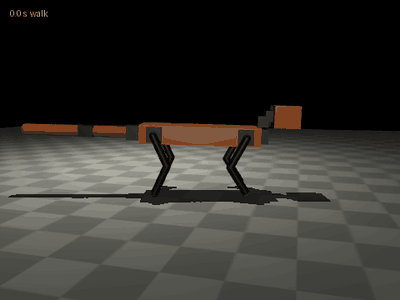
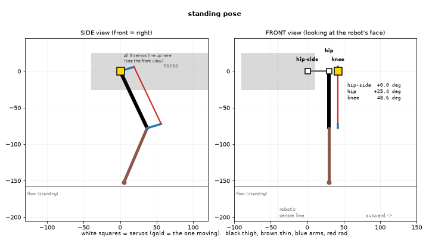

# red-panda-bot

A small red panda robot that walks on four legs, rears up into a tripod stance using its tail as a third support, and recovers from falls. All movement skills are learned with reinforcement learning in simulation and transferred to real hardware.

**Status:** Phase 1, simulation (started Nov 2026): walking, turning, rearing into the tail tripod and coming back down all work in sim, on nominal and randomized robots. CAD of the real robot has started (Onshape); the servo test rig and first printed leg come in January 2027.

*In simulation (MuJoCo, rough box model): walking, rearing up into the tail tripod while still walking, holding, coming back down, and walking away. Three separate learned policies, switched the moment each one reports it is done.*

## Milestone: the whole Tier 1 movement chain works in simulation

32 of 32 simulated robots go through the full chain without a fall (`tools/eval/chain_check.py`; nominal robot: flat floor, no shoves, 20 ms servo delay):

| Skill | Result in sim |
|---|---|
| Walk (lateral-sequence walk like a real red panda, 0.12 m/s) | 0 falls |
| Rear up into the tail tripod, starting while walking | 32/32, median 0.84 s |
| Hold the tripod (~70° nose-up, tail as the third support) | 32/32, held 3 s |
| Come back down onto four feet | 32/32 ready to walk, median 1.4 s, front paws touch down at ~0.2 m/s |
| Walk off the moment it lands | 0 falls, 34 cm in 3 s (ideal 36) |

**On a randomized robot** (each one with its own friction, servo stiffness, mass, balance point, servo delay and calibration error, and shoves during every skill): 0 falls in any phase, 30 of 32 ready to walk again after coming down (`chain_check.py --random`).

**Turning on command** (`tools/eval/turn_check.py`): turns in place and on curves at 81-97% of the asked rate, 0 falls over 8 joystick commands x 32 robots, nominal and randomized.

Each skill is learned with PPO in MuJoCo Playground, thousands of robots in parallel on one GPU, with the servo's torque-speed limit, random servo delay, calibration error, mass changes and shoves during training so the policies don't rely on a perfect robot. Torque and impact loads are measured in sim and checked against the servo's ratings (`tools/eval/down_load.py`, `tools/eval/tripod_static.py`).

Some things that had to be solved along the way (details in `logs/log.md`):
- **Rearing** was learned with a reverse curriculum: start right next to the tripod pose, then from further and further away, down to a walking start.
- **Coming down:** an all-or-nothing "four feet down" reward taught the robot to stand on three legs with one paw in the air. A graded reward plus retraining from scratch fixed it; a front-leg symmetry term made it faster and even.
- **Hardware strain:** measuring every 4 ms (not every 20 ms) showed the hind hip servos being forced backwards at full torque while the body tips forward. A cost on exactly that removed most of it.

## Now: designing the real leg

*One hind leg, sim dimensions. Three servos per leg: hip-side (leg outward), hip (swing), knee. The knee servo rides on the thigh at the hip and drives the shin through a rod, so it sets the knee bend exactly like the sim's knee joint and the trained policies carry over.*

- **Sim numbers -> CAD:** `cad/sim_dims.py` writes every dimension the policies trained on as Onshape variables (`cad/variables.md`), so the CAD skeleton matches the sim.
- **Knee rod linkage:** `cad/knee_linkage.py` takes every knee torque from the full simulated chain and works out the rod force for any lever length, lever angle and rod size. Chosen: 20 mm lever on the kneecap side, 50° off the thigh at a straight knee (never near the angle where the rod lines up with the lever and jams), M4 rod. Rod force 74 N 99% of the time, 192 N at most with the servo at full torque, against ~1200 N to buckle the rod. Why 50°: `cad/knee_angle_compare.gif`.
- Choosing the knee drive itself also came from sim: a knee servo fixed in the body would have needed the hip servos to reach 4.5 N·m (stall is 2.94); on the thigh, 0 N·m extra (`chain_check.py --legs`).

**Next:** Onshape skeleton and one leg; servo test rig in January (servo model identification with BAM, bus timing at 50 Hz); first printed leg; then the CAD's real masses back into the sim and retrain.

## Repo layout

| Folder | Contents |
|---|---|
| `sim/` | Simulation environments, robot model, rewards, training configs |
| `robot/` | On-robot code: control loop, servo driver, policy runtime, personality |
| `tools/` | Logging, plotting, evaluation, converters |
| `cad/` | Onshape numbers from the sim, knee linkage calculator, leg animations |
| `data/` | Recorded servo data and small results |
| `logs/log.md` | Day-by-day build log |
| `media/` | Small GIFs for this page |

## Credits

This project rebuilds known methods; the tail is the new part.

- Schulman et al., "Proximal Policy Optimization Algorithms" (2017)
- Rudin et al., "Learning to Walk in Minutes Using Massively Parallel Deep Reinforcement Learning" (2021)
- Zakka et al., "MuJoCo Playground" (2025), with Brax's PPO; the Go1 joystick example is the starting point for the rewards
- Hwangbo et al., "Learning agile and dynamic motor skills for legged robots" (Science Robotics, 2019)
- Rhoban, BAM servo identification
- Lee et al., "Learning quadrupedal locomotion over challenging terrain" (Science Robotics, 2020)
- Kumar et al., "RMA: Rapid Motor Adaptation for Legged Robots" (2021)
- Florensa et al., "Reverse Curriculum Generation for Reinforcement Learning" (2017); the start-pose ladder used to learn rearing
- Lee et al., "Robust Recovery Controller for a Quadrupedal Robot using Deep Reinforcement Learning" (2019)
- Margolis & Agrawal, "Walk These Ways" (2022); the footfall-schedule idea behind the red panda walk
- Plocek & Dunham, red panda walking kinematics at Cleveland Metroparks Zoo (2023, Case Western Reserve University); evidence that red pandas use a lateral-sequence walk
- Grandia et al., "Design and Control of a Bipedal Robotic Character" (Disney Research, 2024)
- Libby et al., "Tail-assisted pitch control in lizards, robots and dinosaurs" (Nature, 2012)
- Stanford Pupper (leg geometry)
- Open Duck Mini (closest existing project)
